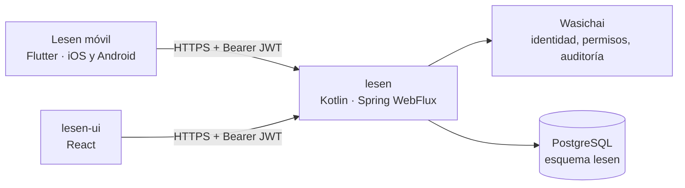

# Visión general

## 1. Ecosistema

- **`wasichai/lesen`** (backend): monolito modular sobre Wasichai 1.10.0. Todo lo de Lesen vive bajo `/api/lesen`, lo
  anónimo bajo `/api/lesen/public`. El contrato vivo se publica en `/api/lesen/public/openapi`.
- **`wasichai/lesen-ui`** (web): cliente de referencia. Sus contratos zod, su modelo del lector (`readerModel.ts`), su
  sincronía de audio (`audioSync.ts`) y sus fixtures capturadas del backend real (`e2e/fixtures/lesen.json`) son la
  referencia de comportamiento de este cliente.
- **`wasichai/lesen-app`** (este repositorio): cliente Flutter independiente. Consume la misma API; no la envuelve en
  una WebView ni replica reglas del backend.

## 2. Auditoría del backend (2026-11-09)

| Capacidad                                        | Estado en el backend                                                                  |
| ------------------------------------------------ | ------------------------------------------------------------------------------------- |
| Login, permisos (`lectura`, `cuaderno`)          | Hecho (Wasichai). JWT HS256 con `expiresAt`; **sin refresco**, sin OIDC, sin registro |
| Idiomas, niveles, temas                          | Hecho (`public/languages`, `public/topics`)                                           |
| Perfil de aprendizaje                            | Hecho (`learner/profile`)                                                             |
| Descubrir, catálogo, ficha                       | Hecho (`discover`, `readings`, `readings/{slug}`)                                     |
| Contenido versionado e inmutable, tokens         | Hecho (ADR-0003 y 0004 del backend)                                                   |
| Traducciones por oración y párrafo               | Hecho                                                                                 |
| Audio con tiempos por palabra                    | Hecho (ADR-0008 del backend); MP3 servido con rangos                                  |
| Progreso, terminar, marcadores, notas, listas    | Hecho; progreso idempotente y porcentaje que solo sube                                |
| Diccionario (lookup, búsqueda, historial, fav.)  | Hecho; sin entrada, `entry: null` (nada inventado)                                    |
| Cuaderno y repaso FSRS-5                         | Hecho; repaso idempotente por `clientId`                                              |
| Comprensión (10 tipos, reglas/IA/autoevaluación) | Hecho (ADR-0009 del backend)                                                          |
| Panel de progreso, metas, logros, resumen        | Hecho en backend (ADR-0011); la web aún lo está terminando                            |
| Estudio editorial                                | Pendiente (fase 6 del backend); no afecta a la app                                    |
| Notificaciones push                              | **No existe**: Wasichai 1.10.0 no tiene API de avisos                                 |

Los huecos que afectan al móvil, con el contrato que se propone para cada uno, están en
[`api-integration.md`](api-integration.md#huecos). Ninguno bloquea las fases 1–7: la app los rodea en el cliente sin
inventar datos y lo documenta.

## 3. Documentos

- [`mobile-architecture.md`](mobile-architecture.md): capas, estructura, estado, navegación, red, temas, l10n.
- [`api-integration.md`](api-integration.md): contrato usado, mapeo de errores, huecos y contratos propuestos.
- [`offline-strategy.md`](offline-strategy.md): base local, descargas, cola de operaciones, conflictos.
- [`audio-synchronization.md`](audio-synchronization.md): motor de audio, ciclo de vida nativo, resaltado eficiente.
- [`../adr/`](../adr/README.md): decisiones.
